<div align="center">

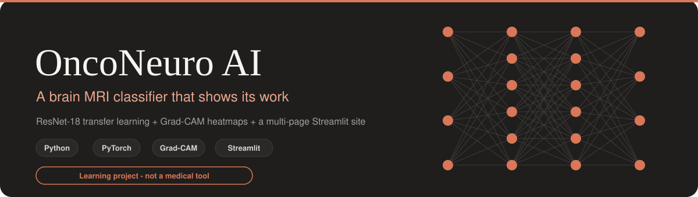

<br>


### An AI that sorts brain MRI pictures into four groups, then shows you *where it looked* to decide.

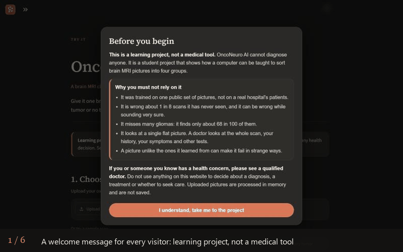

</div>

> ### Read this first
> **OncoNeuro AI is a learning project, not a medical tool. It cannot diagnose anyone.**
> It was trained on one public set of pictures, it is wrong about 1 scan in 8, and it misses about a third of gliomas.
> Never use it for any health decision. If you or someone you know has a health concern, please see a doctor.
> I put these limits on the website too: every visitor sees a welcome message that says exactly this.

---

## Contents

| | |
|---|---|
| [1. The 30-second version](#1-the-30-second-version) | [7. Results, honestly](#7-results-honestly) |
| [2. See it in action](#2-see-it-in-action) | [8. The website](#8-the-website) |
| [3. How it works, step by step](#3-how-it-works-step-by-step) | [9. Tools I used](#9-tools-i-used) |
| [4. Transfer learning, explained for everyone](#4-transfer-learning-explained-for-everyone) | [10. Resources and credits](#10-resources-and-credits) |
| [5. Grad-CAM: looking inside the black box](#5-grad-cam-looking-inside-the-black-box) | [11. How I built it](#11-how-i-built-it) |
| [6. The data](#6-the-data) | [12. Run it yourself](#12-run-it-yourself) |
| | [13. Limits, ethics and what is next](#13-limits-ethics-and-what-is-next) |

---

## 1. The 30-second version

**Imagine** showing a student thousands of brain scans, each with the right answer written on the back, until they start to
recognize patterns. That is all this project does, with a computer as the student.

You give it **one brain MRI picture**. It answers two questions:

1. **Which of four groups does this look most like?** Glioma, meningioma, pituitary tumor, or no tumor.
2. **Where in the picture did you look to decide?** It paints a colored heatmap over those places.

The second question is the interesting one. Plenty of AI projects only report a score. This one also shows its reasoning,
so you can notice when it is right for the wrong reasons, and I report where it fails, not just where it works.

<table>
<tr>
<td width="50%" valign="top">

**What I built**

- a model that classifies brain MRI pictures
- heatmaps that explain each answer
- a multi-page website (light and dark mode, works on phones)
- an 11-chapter documentation book in plain words
- a 3D "About me" page
- training, evaluation and graphics scripts

</td>
<td width="50%" valign="top">

**What I learned**

- how transfer learning reuses what a network already knows
- how to test honestly on pictures the model never saw
- why a high score is not the same as a safe tool
- how to explain a model with Grad-CAM
- how to keep a site fast when PyTorch takes 20 seconds to load

</td>
</tr>
</table>

<details>
<summary><b>New to AI? Tiny glossary (click to open)</b></summary>

| Word | Plain meaning |
|---|---|
| **MRI** | A scanner that uses a magnet and radio waves to take detailed pictures inside the body. A brain MRI is a stack of slices, like bread. This project uses single slices. |
| **Model** | A program that learned from examples instead of being given rules. |
| **Neural network** | A model built from many tiny connected number-crunchers, loosely inspired by brain cells. |
| **Training** | Showing the model labelled examples and nudging its numbers until its answers match the labels more often. |
| **Transfer learning** | Starting from a network that already learned to see, instead of starting from nothing. |
| **Frozen** | Locked, so training cannot change it. |
| **Epoch** | One full pass over all the training pictures. |
| **Accuracy** | Out of all test pictures, the share it got right. |
| **Recall** | Of the real cases in a group, the share it found. |
| **Precision** | Of the pictures it put in a group, the share that really belong. |
| **Grad-CAM** | A method that highlights which parts of a picture pushed the model toward its answer. |

</details>

---

## 2. See it in action

> A hosted version is being set up. Until then, run it on your own computer with three commands: see [Run it yourself](#12-run-it-yourself).

<div align="center">

| | |
|---|---|
| **The welcome message every visitor sees** <br> 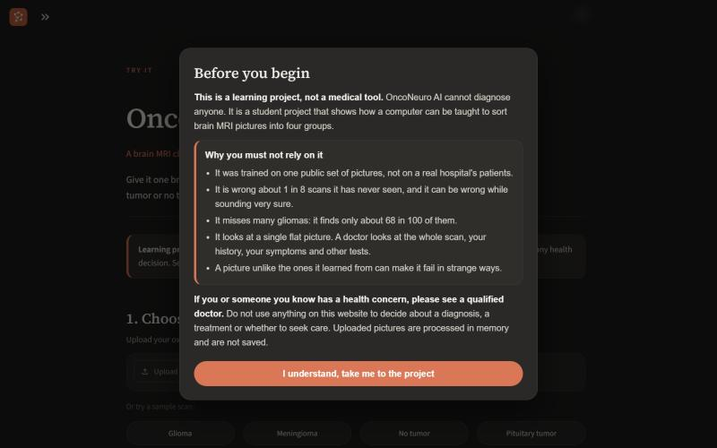 | **Pick a scan, see where the model looked (dark mode)** <br> 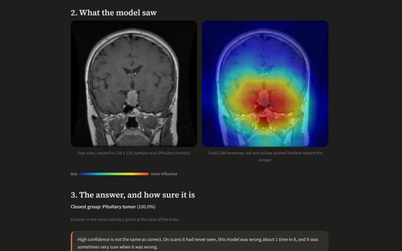 |
| **Same page in light mode** <br> 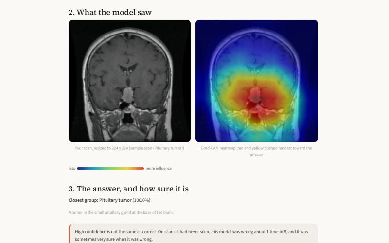 | **"Our journey": how it was built, step by step** <br> 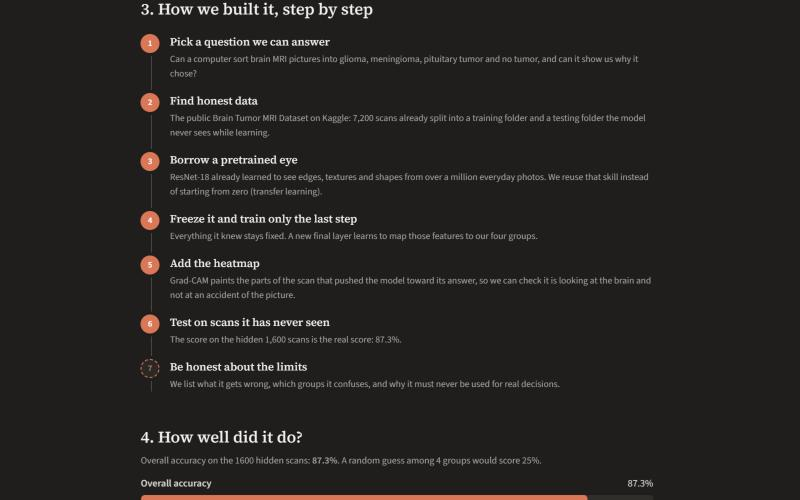 |
| **A 3D hologram "About me" that reacts as you scroll** <br> 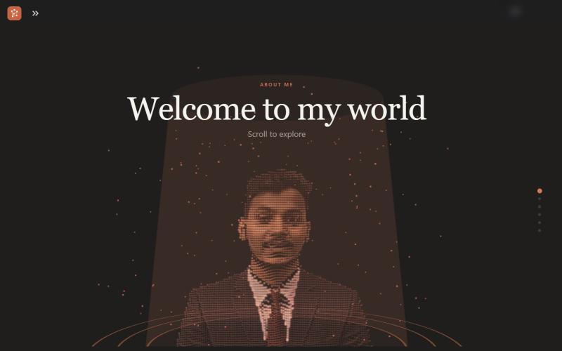 | **An 11-chapter documentation book** <br> 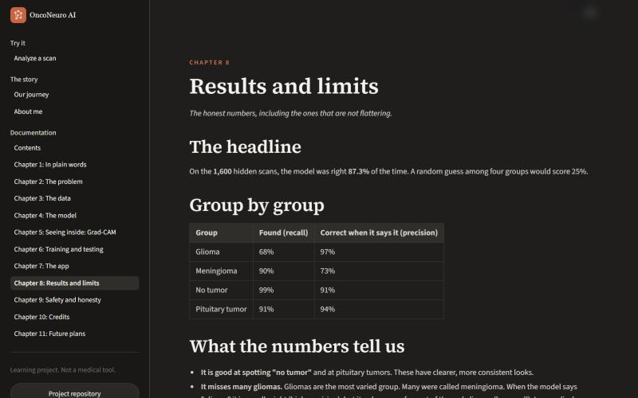 |

### Two rotating 3D views made from the real data

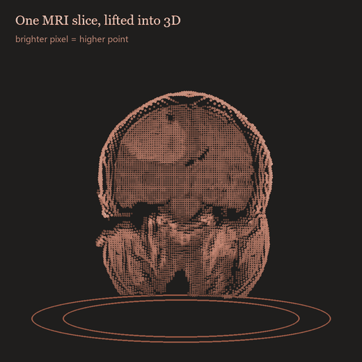 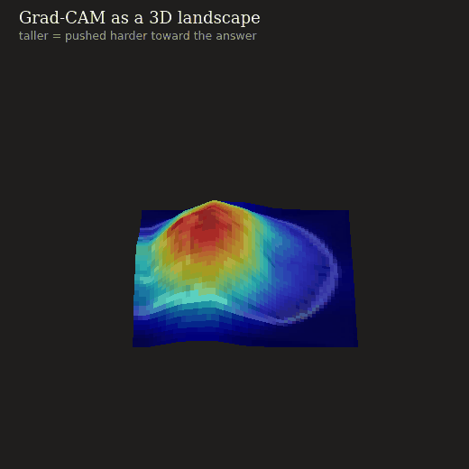

*Left: one MRI slice lifted into 3D (brighter pixel, higher point). Right: the Grad-CAM heatmap of a real prediction as a 3D landscape (taller means pushed harder toward the answer).*

</div>

---

## 3. How it works, step by step

<div align="center">
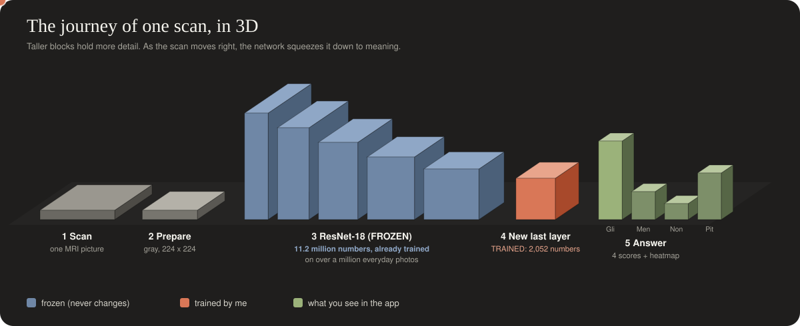
</div>

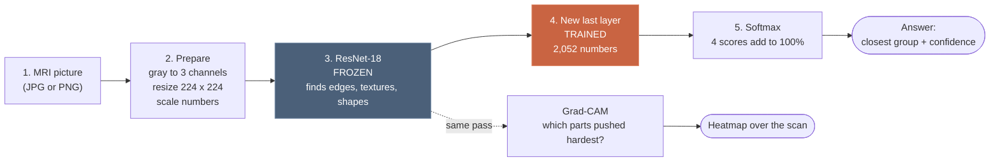

| Step | What happens | Why it is done |
|---|---|---|
| **1. Scan** | You upload a JPG or PNG, or click a built-in sample. | The only input the model needs. |
| **2. Prepare** | Convert to grayscale then copy to 3 channels, resize to 224 x 224, scale the numbers with ImageNet's averages. | ResNet-18 was trained on 224 x 224 color pictures, so we make ours look familiar to it. |
| **3. ResNet-18 (frozen)** | The picture passes through 18 layers that detect edges, then textures, then shapes. | Re-use what it learned from over a million photos. |
| **4. New last layer (trained)** | One small layer turns 512 features into 4 scores. It is the only part that learned from MRI pictures. | Cheap, fast, and hard to over-train. |
| **5. Softmax** | The 4 scores become percentages that add up to 100%. | Easier to read. Note: it shows how strongly the model leans, not how likely it is to be right. |
| **Grad-CAM** | From the same pass, find which parts of the picture pushed hardest toward the chosen answer. | So you can check the model is looking at the brain and not at an accident of the picture. |

---

## 4. Transfer learning, explained for everyone

Teaching a network to see from nothing takes millions of pictures and a lot of computing power. A shortcut: start from
**ResNet-18**, a network that already learned to see by studying **over a million everyday photos** (dogs, cars, mugs).
It already knows edges, corners and textures. Those skills carry over to MRI pictures surprisingly well.

So I **froze** everything it knew and trained only a **new last layer** that turns what it sees into my four groups.

<div align="center">
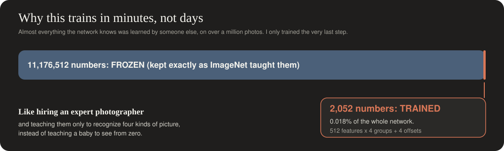
</div>

Think of hiring an expert photographer and teaching them to recognize four specific kinds of picture, instead of teaching a
baby to see from zero.

<details>
<summary><b>The training recipe in detail (click to open)</b></summary>

1. Download the dataset (Kaggle, through `kagglehub`).
2. Prepare pictures: grayscale to 3 channels, resize 224 x 224, normalize with ImageNet mean and standard deviation.
3. Load `resnet18` with ImageNet weights, set `requires_grad = False` on every parameter, attach `nn.Linear(512, 4)`.
4. Train only that layer: **Adam**, learning rate **0.001**, **cross-entropy** loss, batch size 32.
5. Test once on the hidden Testing folder.
6. Draw Grad-CAM heatmaps on `layer4[-1]`.
7. Save `onconeuro_resnet18.pt` and load it in the website.

**Speed trick for slow computers:** because the frozen part never changes, `train_local.py` computes each picture's 512
features once and trains the last layer on those saved features. The Colab notebook (`onconeuro_train.ipynb`) trains the
standard way on a free GPU and also includes an optional fine-tuning step (`lr = 1e-4`).

</details>

---

## 5. Grad-CAM: looking inside the black box

A score tells you *how often* a model is right. A heatmap helps you see whether it is right *for the right reasons*.
Models can cheat: a model might learn a marker or an edge pattern that happens to go with a label, score well, and be
useless in the real world.

**Grad-CAM** asks one question: *which parts of the picture most increased the score of the chosen answer?* It colors them
from blue (almost no influence) to red (the strongest push).

<div align="center">

| What you see | What it may mean |
|---|---|
| Red on a patch inside the brain | The model may be reacting to something real |
| Red on the skull edge, the black background or a corner | The model is probably relying on something unrelated. **Do not trust that answer.** |
| Heat spread over the whole head | The model is not focusing on anything specific |

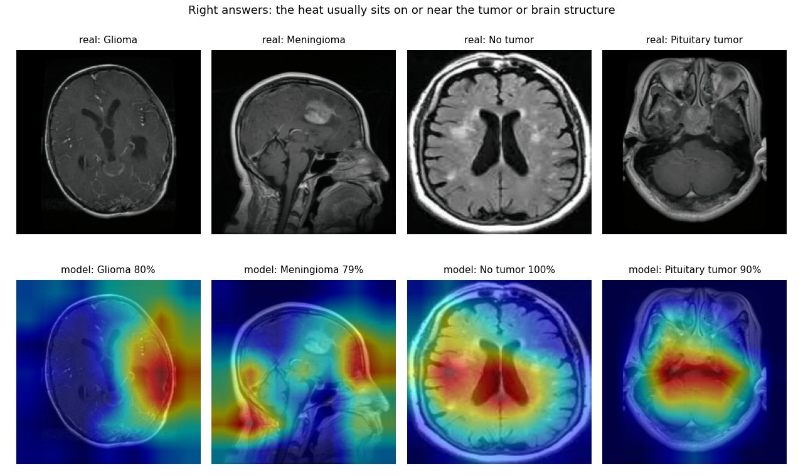
<br><br>
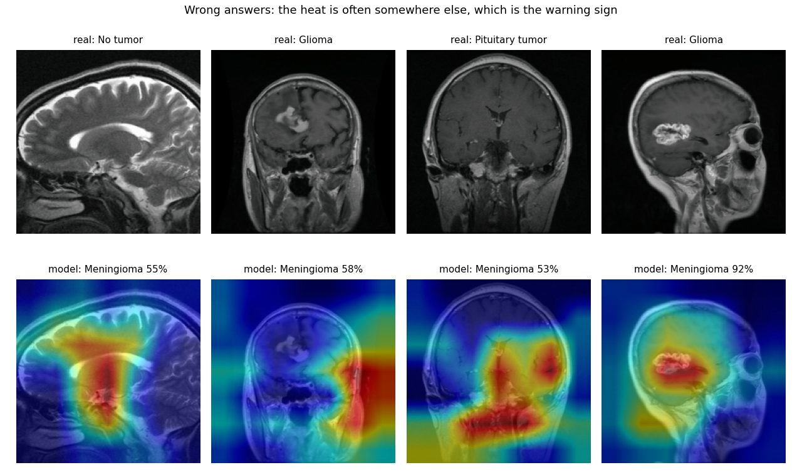

*Top: four right answers. Bottom: four mistakes. Notice how often the heat sits away from any obvious tumor when the model is wrong.*

</div>

> **Careful:** a Grad-CAM map is coarse (a 7 x 7 grid stretched over the picture). It is **not** an outline of a tumor, and a
> nice-looking heatmap does not prove a correct answer.

---

## 6. The data

I used the public **[Brain Tumor MRI Dataset](https://www.kaggle.com/datasets/masoudnickparvar/brain-tumor-mri-dataset)** on Kaggle
by Masoud Nickparvar: **7,200 scans** in four groups, already split so the model never sees the test pictures while learning.

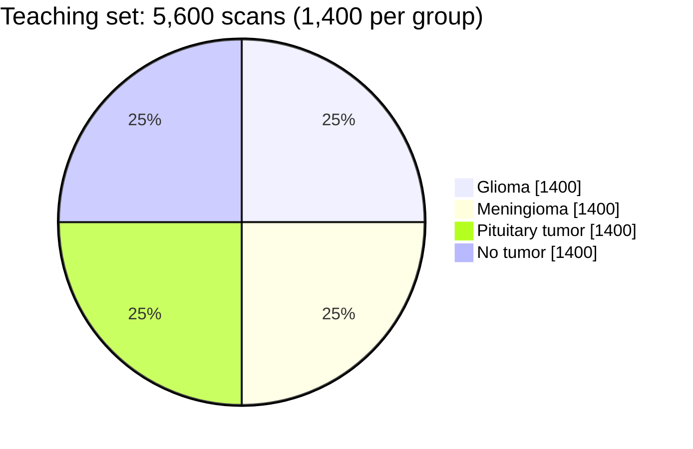

| Part | Scans | Used for |
|---|---|---|
| **Training** | 5,600 (1,400 per group) | The model learns from these |
| **Testing** | 1,600 (400 per group) | Hidden. Used once, at the end, for an honest score |

**What can go wrong with this data (and why it matters):**

- **One source.** One public collection, not many hospitals and scanners. A different scanner may look different and fool the model.
- **Single slices.** Real scans have many slices; each file here is one picture.
- **Possible overlap.** If slices from the same patient are in both folders, the test score may look better than it really is.
- **Human labels.** People make mistakes.
- **Unknown people.** No information on ages or backgrounds, so I cannot claim it works fairly for everyone.
- **Only four answers.** Show it something else entirely and it will still choose one of the four.

---

## 7. Results, honestly

<div align="center">
</div>

On the **1,600 scans it had never seen**, the model was right **87.3%** of the time (random guessing among four groups scores 25%).

| Group | Found (recall) | Correct when it says it (precision) | F1 |
|---|---|---|---|
| Glioma | **68%** (273 of 400) | 97% | 0.80 |
| Meningioma | 90% (362 of 400) | 73% | 0.81 |
| No tumor | 99% (397 of 400) | 91% | 0.95 |
| Pituitary tumor | 91% (364 of 400) | 94% | 0.92 |

<div align="center">
</div>

**What the numbers say:**

- It is very good at spotting **"no tumor"** and decent at **pituitary tumors**, which have clearer, more consistent looks.
- It **misses many gliomas**: 95 of 400 were called meningioma. When it says "glioma" it is usually right, but it only says so for part of the real ones. In medicine, **missing a tumor is the costly mistake.**
- It is **confidently wrong** sometimes. Average confidence was 92% on right answers and still **73% on wrong ones**, so confidence is not a reliable warning light.
- About **1 scan in 8 is wrong**. Across thousands of people that would be thousands of wrong answers.

---

## 8. The website

A multi-page Streamlit site with a warm cream-and-terracotta look inspired by Claude, a sun-and-moon theme switch, and a
layout that adapts from phones to wide monitors.

| Page | What it has |
|---|---|
| **Analyze a scan** | Upload a picture or click a sample. Shows the scan, the Grad-CAM heatmap, the answer, a bar for every group, and a stronger warning when the model is unsure. |
| **Our journey** | The path of a scan, counters, a 7-step build timeline, accuracy bars and a confusion matrix. |
| **About me** | A 3D hologram built with **three.js** and **GSAP** that reacts as you scroll. Links to this repo, my profile and LinkedIn. |
| **Documentation** | 12 chapters: plain words, the problem, the data, the model, Grad-CAM, training and testing, the app, results, safety, credits, future plans (an animated roadmap). |

**Details worth knowing**

- A **welcome message** appears for every new visitor: learning project, not a medical tool, and why.
- **Light and dark mode** with an animated sun-and-moon switch that remembers your choice.
- **Works on every screen:** fluid layout, big tap targets, tables that scroll sideways, calmer motion for people who prefer less.
- **Private by default:** uploaded pictures are processed in memory and never saved.
- **Accessible:** keyboard-friendly pop-up (Escape closes it), good contrast in both themes.

### How it stays fast

PyTorch and Grad-CAM take about **20 seconds** just to import. Inside the website's own process that froze every page. So the
heavy part runs next door, in a **background worker** process, and the site stays instant.

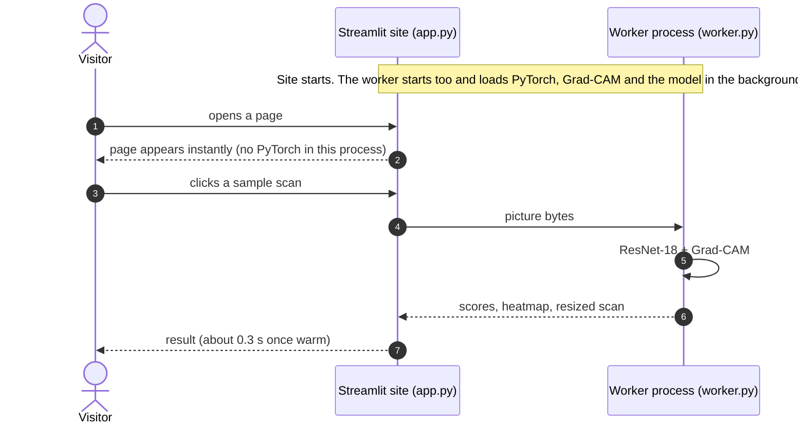

| Measured on my PC | Time |
|---|---|
| Switching between sections | about 0.1 to 0.3 s |
| Analyzing a scan (worker warm) | about 0.3 s |
| Before the fix: opening Analyze | 5 to 10 s |

---

## 9. Tools I used

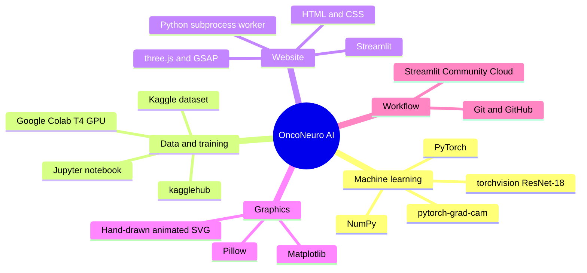

| Area | Tool | What it does here |
|---|---|---|
| Language | **Python 3.11** | Everything |
| Deep learning | **PyTorch 2.15**, **torchvision 0.29** | ResNet-18, training, inference |
| Explainability | **pytorch-grad-cam 1.5.7** | Grad-CAM heatmaps |
| Numbers and images | **NumPy**, **Pillow** | Preparing pictures, drawing overlays |
| Plots | **Matplotlib** | Example galleries and the 3D heatmap landscape |
| Website | **Streamlit 1.67** | All pages and the welcome pop-up |
| 3D About page | **three.js r128**, **GSAP 3.12** | The hologram that reacts to scrolling |
| Data download | **kagglehub**, Kaggle | Fetching the dataset |
| Training | **Google Colab** (free T4 GPU), `train_local.py` | Training in the cloud or on a laptop |
| Graphics | hand-written SVG (SMIL animation), Pillow | The 3D charts and GIFs in this README |
| Hosting | **GitHub**, **Streamlit Community Cloud** | Code and the live site |

---

## 10. Resources and credits

This project stands on other people's work. Thank you.

| What | Link |
|---|---|
| **Dataset:** Brain Tumor MRI Dataset (Masoud Nickparvar) | https://www.kaggle.com/datasets/masoudnickparvar/brain-tumor-mri-dataset |
| **Transfer learning tutorial** (PyTorch) | https://docs.pytorch.org/tutorials/beginner/transfer_learning_tutorial.html |
| **pytorch-grad-cam** (Jacob Gildenblat) | https://github.com/jacobgil/pytorch-grad-cam |
| **Grad-CAM paper:** Selvaraju et al., *Grad-CAM: Visual Explanations from Deep Networks via Gradient-based Localization* | https://arxiv.org/abs/1610.02391 |
| **ResNet paper:** He, Zhang, Ren, Sun, *Deep Residual Learning for Image Recognition* (2015) | https://arxiv.org/abs/1512.03385 |
| **ImageNet:** the photo collection ResNet-18 first learned from | https://www.image-net.org |
| **Streamlit** | https://streamlit.io |
| **three.js** and **GSAP** (the 3D About page) | https://threejs.org , https://gsap.com |

Design inspiration: Claude's warm cream and terracotta style, and my earlier project
[The Nose-tral Network (Aroma-GPT)](https://github.com/gravityyyy99/the-nose-tral-network).
The sample scans in `assets/samples/` come from the dataset above; please check its Kaggle page for its terms.

---

## 11. How I built it

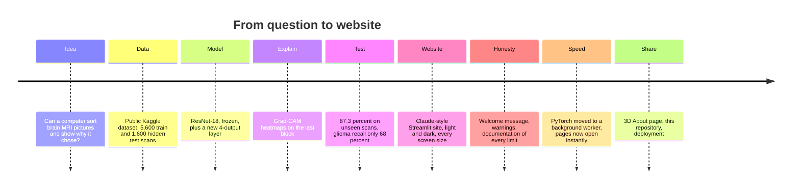

**Thought process, in one list**

1. **Pick a question I can finish.** Four groups keep it simple.
2. **Use honest data.** Train and test folders kept apart; test used once.
3. **Borrow, then freeze.** Fewer trained numbers means less chance of memorizing the training pictures.
4. **Make the model accountable.** A heatmap beside every answer.
5. **Report the bad numbers.** The glioma weakness is on the site and in this README.
6. **Design for everyone.** Plain words, light and dark mode, phones to monitors.
7. **Keep it fast.** Measure, find the real cause, fix that.

---

## 12. Run it yourself

**Open the website on your computer**

```bash
git clone https://github.com/gravityyyy99/onconeuro-ai.git
cd onconeuro-ai
pip install -r requirements.txt
streamlit run app.py
```

The trained model (`onconeuro_resnet18.pt`, 45 MB) is already in the repo. The first scan after the site starts can take a
few seconds while the background worker finishes loading PyTorch.

**Train it again yourself**

- **In the cloud (easiest):** upload `onconeuro_train.ipynb` to [Google Colab](https://colab.research.google.com), choose **Runtime > Change runtime type > T4 GPU**, and run the cells in order.
- **On your computer:** download the dataset, then run

```bash
python train_local.py  /path/to/brain-tumor-mri-dataset     # trains and saves onconeuro_resnet18.pt
python evaluate.py     /path/to/brain-tumor-mri-dataset     # writes evaluation.json and the example galleries
python tools/make_readme_graphics.py --gifs                 # redraws the charts and 3D GIFs in this README
```

<details>
<summary><b>Project structure (click to open)</b></summary>

```text
onconeuro-ai/
|-- app.py                  site entry: navigation, welcome pop-up, theme switch
|-- ui.py                   Claude-style CSS, responsive rules, sun-and-moon switch
|-- analyze_page.py         upload / sample scan, heatmap, answer, warnings
|-- journey_page.py         "Our journey": timeline, accuracy, confusion matrix
|-- about_page.py           3D hologram About page (three.js + GSAP)
|-- docs_pages.py           builds the documentation book from docs_content/
|-- model.py                model loading, preprocessing, prediction + Grad-CAM (PyTorch)
|-- worker.py               background process that runs model.py so pages never freeze
|-- labels.py               light constants (class names) shared by every page
|-- train_local.py          fast local training (frozen features, last layer only)
|-- evaluate.py             scores the hidden test set, writes evaluation.json, example images
|-- onconeuro_train.ipynb   Google Colab notebook: the full training walkthrough
|-- make_notebook.py        regenerates the notebook
|-- onconeuro_resnet18.pt   the trained model
|-- evaluation.json         the real test results the site and charts read
|-- docs_content/           the 12 documentation chapters (Markdown)
|-- assets/                 logos, sample scans, example heatmaps, 3D page, photo
|-- docs/img/               charts and 3D graphics used in this README
|-- docs/screenshots/       real screenshots of the site
`-- tools/                  scripts that draw this README's graphics
```

</details>

---

## 13. Limits, ethics and what is next

**It is wrong in both directions.** A false "no tumor" could make someone feel safe when they should not. A false "tumor" could
cause terrible fear. **It sounds sure while wrong.** **It does not know what it does not know.** It has **not** been tested the
way medicine requires: no clinical trials, no fairness checks across groups of people, no regulator approval.

**Roadmap**

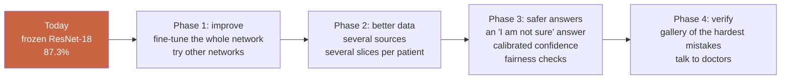

Even if every phase gets done, this stays a learning project unless it goes through the process real medical tools go through.

---

<div align="center">

### Built by **Dibyajyoti Pradhan**

[GitHub profile](https://github.com/gravityyyy99) &nbsp;|&nbsp; [LinkedIn](https://www.linkedin.com/in/dibyajyotipradhan/) &nbsp;|&nbsp; [The Nose-tral Network](https://github.com/gravityyyy99/the-nose-tral-network)

**Learning project. Not a medical tool. If you have a health concern, please see a doctor.**

</div>
